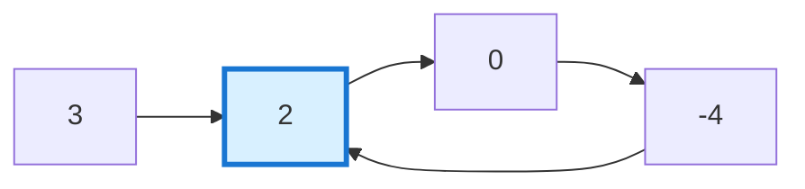
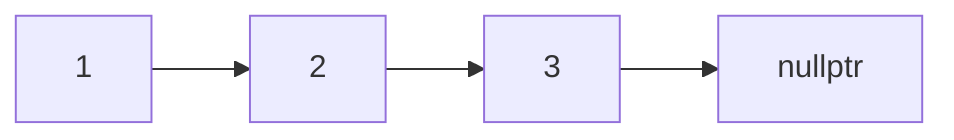

# 142. Linked List Cycle II

**LeetCode:** [142. Linked List Cycle II](https://leetcode.com/problems/linked-list-cycle-ii/)  
**Difficulty:** Medium  
**Topics:** Hash Table, Linked List, Two Pointers

## Problem Statement

Given the head of a linked list, return the node where the cycle begins. If there is no cycle, return `nullptr`.

A cycle exists when a node's `next` pointer points to a previous node in the list, allowing traversal to continue indefinitely. The parameter `pos` indicates the index that the tail connects to. It is used by the test system and is **not passed** to your function.

Do not modify the linked list.

## Examples

### Example 1
**Input:** `head = [3,2,0,-4]`, `pos = 1`  
**Output:** Tail connects to node index `1` (value `2`).

### Example 2
**Input:** `head = [1,2]`, `pos = 0`  
**Output:** Tail connects to node index `0` (value `1`).

### Example 3
**Input:** `head = [1]`, `pos = -1`  
**Output:** No cycle; return `nullptr`.


## Visual Representation of a Cycle

In this example, the last node (`-4`) points back to the node with value `2`. This creates a cycle.



- The list starts at node `3`.
- The cycle begins at node `2`.
- The links continue `2 → 0 → -4 → 2 → ...` forever.
- Your function must return a pointer to node `2`, not the value `2` alone.

### Example without a cycle



Since the list eventually reaches `nullptr`, there is no cycle and the function returns `nullptr`.

## Constraints

- The number of nodes in the list is in the range `[0, 10^4]`.
- `-10^5 <= Node.val <= 10^5`.
- `pos` is `-1` or a valid index in the linked list.
- `pos` is not passed as an argument.

## Function Signature

```cpp
ListNode *detectCycle(ListNode *head);
```

See [`leetcode_142_explanation.md`](leetcode_142_explanation.md) for both approaches: Floyd's cycle detection and a hash set.
