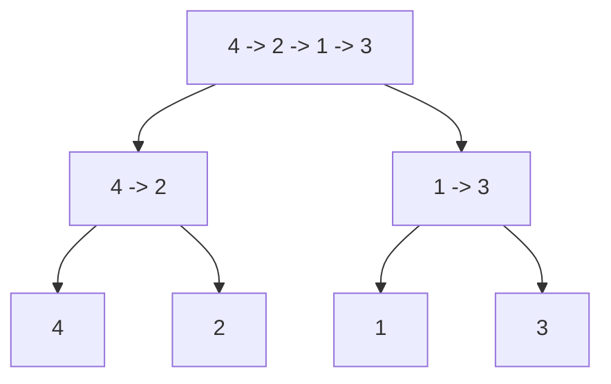
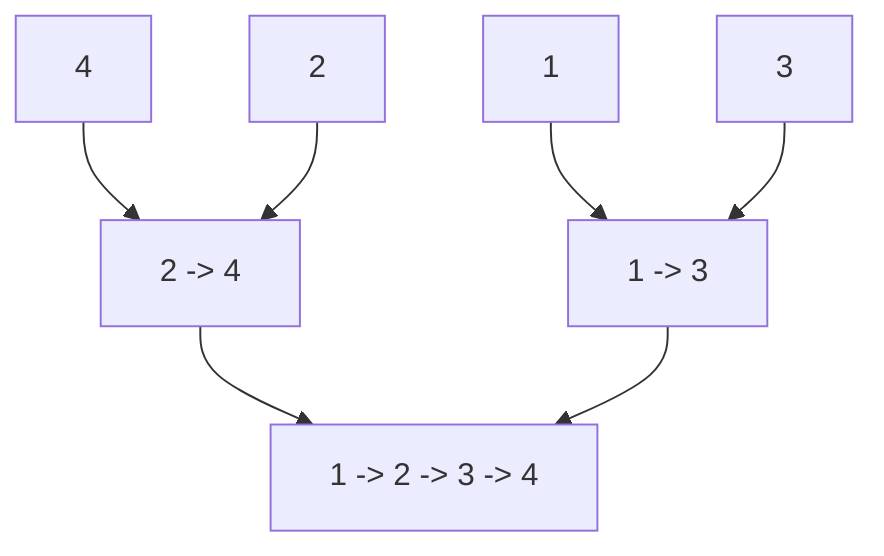

# 148. Sort List — Merge Sort Explained

**LeetCode:** [148. Sort List](https://leetcode.com/problems/sort-list/)  
**Difficulty:** Medium | **Language:** C++

## 1. Core Idea

Use merge sort:

1. Find the middle of the linked list.
2. Split it into two independent halves.
3. Recursively sort each half.
4. Merge the sorted halves.

Keep splitting until every sublist has zero or one node. Such a list is already sorted.

## 2. Complete Code

```cpp
class Solution {
public:
    ListNode* getMiddle(ListNode* head) {
        ListNode* slow = head;
        ListNode* fast = head->next;

        while (fast != nullptr && fast->next != nullptr) {
            slow = slow->next;
            fast = fast->next->next;
        }
        return slow;
    }

    ListNode* mergeList(ListNode* left, ListNode* right) {
        ListNode dummy(0);
        ListNode* tail = &dummy;

        while (left != nullptr && right != nullptr) {
            if (left->val <= right->val) {
                tail->next = left;
                left = left->next;
            } else {
                tail->next = right;
                right = right->next;
            }
            tail = tail->next;
        }

        if (left != nullptr) tail->next = left;
        else tail->next = right;

        return dummy.next;
    }

    ListNode* sortList(ListNode* head) {
        if (head == nullptr || head->next == nullptr) {
            return head;
        }

        ListNode* middle = getMiddle(head);
        ListNode* right = middle->next;
        middle->next = nullptr;

        ListNode* left = sortList(head);
        right = sortList(right);

        return mergeList(left, right);
    }
};
```

## 3. Explain Each Function

### A. `getMiddle()`

```cpp
ListNode* slow = head;
ListNode* fast = head->next;
```

`slow` moves one node at a time and `fast` moves two. Starting `fast` at `head->next` makes `slow` stop at the last node of the left half, so the split works correctly for even-sized lists.

```cpp
while (fast != nullptr && fast->next != nullptr) {
    slow = slow->next;
    fast = fast->next->next;
}
```

When the loop ends, `slow` points to the middle/left-half endpoint.

### B. Split the list

```cpp
ListNode* middle = getMiddle(head);
ListNode* right = middle->next;
middle->next = nullptr;
ListNode* left = head;
```

Save the second half's first node in `right`, then break the link by assigning `middle->next = nullptr`.

Before:
```text
4 -> 2 -> 1 -> 3 -> nullptr
```

After:
```text
4 -> 2 -> nullptr
1 -> 3 -> nullptr
```

### C. Recursively sort the halves

```cpp
left = sortList(left);
right = sortList(right);
```

Each half is split and sorted the same way. The base case stops recursion:

```cpp
if (head == nullptr || head->next == nullptr) return head;
```

An empty list or a single-node list is already sorted.

### D. `mergeList()`

`dummy` is a temporary sentinel node. `tail` always points to the last node in the result being built.

Compare the current nodes from `left` and `right`; link the smaller one to `tail->next`, advance that list's pointer, and then advance `tail`. When one half runs out, attach the remainder of the other half.

`return dummy.next` returns the first real node, not the sentinel. The algorithm reuses the existing list nodes rather than creating replacement nodes for every value.

## 4. Visual Recursion

Input:
```text
4 -> 2 -> 1 -> 3 -> nullptr
```

### Split phase



### Merge phase



## 5. Dry Run

Input: `[4,2,1,3]`

| Stage | Left half | Right half | Result |
|---|---|---|---|
| First split | `[4,2]` | `[1,3]` | — |
| Split left | `[4]` | `[2]` | — |
| Merge left | `[2]` | `[4]` | `[2,4]` |
| Split right | `[1]` | `[3]` | — |
| Merge right | `[1]` | `[3]` | `[1,3]` |
| Final merge | `[2,4]` | `[1,3]` | `[1,2,3,4]` |

## 6. Complexity Analysis

Let `n` be the number of nodes.

- **Time: `O(n log n)`** — there are `O(log n)` levels of splitting, and merging across each level processes `O(n)` nodes.
- **Auxiliary space: `O(log n)`** — the recursion stack has logarithmic depth. The merge step relinks existing nodes and does not use an `O(n)` temporary array.

## 7. Common Mistakes

1. Forgetting `middle->next = nullptr`, leaving the halves connected and risking infinite recursion.
2. Choosing the wrong initial position for `fast` in `getMiddle()`.
3. Forgetting to connect the remaining nodes after the merge loop.
4. Returning `dummy` rather than `dummy.next`.
5. Forgetting the base case for an empty or one-node list.

## Key Takeaway

Merge sort is well suited to linked lists: it achieves `O(n log n)` time by repeatedly splitting the list and merging sorted halves, without requiring random access or an `O(n)` temporary array.
