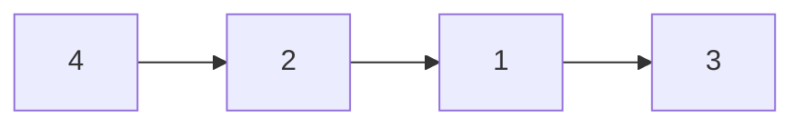
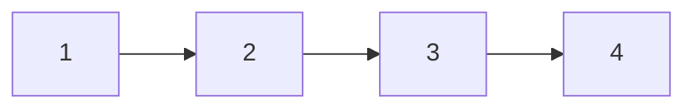

# 148. Sort List

**LeetCode:** [148. Sort List](https://leetcode.com/problems/sort-list/)  
**Difficulty:** Medium  
**Topics:** Linked List, Two Pointers, Divide and Conquer, Sorting, Merge Sort

## Problem Statement

Given the `head` of a linked list, return the list after sorting it in **ascending order**.

## Examples

### Example 1
**Input:** `head = [4,2,1,3]`  
**Output:** `[1,2,3,4]`

### Example 2
**Input:** `head = [-1,5,3,4,0]`  
**Output:** `[-1,0,3,4,5]`

### Example 3
**Input:** `head = []`  
**Output:** `[]`

## Constraints

- The number of nodes in the list is in the range `[0, 5 * 10^4]`.
- `-10^5 <= Node.val <= 10^5`.

## Visual Representation

### Before sorting



### After sorting



The function must rearrange the list into ascending order and return the head of the sorted list.

```cpp
ListNode* sortList(ListNode* head);
```

See [`leetcode_148_explanation.md`](leetcode_148_explanation.md) for the merge sort strategy, code walkthrough, recursion dry run, and complexity analysis.
