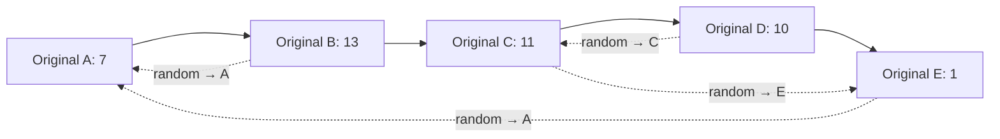

# 138. Copy List with Random Pointer

**LeetCode:** [138. Copy List with Random Pointer](https://leetcode.com/problems/copy-list-with-random-pointer/)  
**Difficulty:** Medium  
**Topics:** Hash Table, Linked List

## Problem Statement

A linked list of length `n` is given. Each node contains:
- `val`: an integer value.
- `next`: a pointer to the next node.
- `random`: a pointer to any node in the list, or `nullptr`.

Construct a **deep copy** of the list with exactly `n` brand-new nodes. Each copied node must have the same value as its corresponding original node. The `next` and `random` pointers must preserve the original relationships, but must point only to nodes in the copied list. No pointer in the copied list may point to an original node.

Return the head of the copied list.

The input is represented as `[val, random_index]` pairs. `random_index` is the index of the node the random pointer points to, or `null` if there is no target. The index is only an input representation; it is not passed to your function.

## Example 1

**Input:** `head = [[7,null],[13,0],[11,4],[10,2],[1,0]]`  
**Output:** `[[7,null],[13,0],[11,4],[10,2],[1,0]]`

**Explanation:** The copied nodes preserve the values and pointer relationships, but are separate node objects.

## Example 2

**Input:** `head = [[1,1],[2,1]]`  
**Output:** `[[1,1],[2,1]]`

## Example 3

**Input:** `head = [[3,null],[3,0],[3,null]]`  
**Output:** `[[3,null],[3,0],[3,null]]`

## Constraints

- `0 <= n <= 1000`
- `-10000 <= Node.val <= 10000`
- `Node.random` is `nullptr` or points to a node in the linked list.

## Visual Representation

Original `next` links go left to right. Dashed arrows show `random` pointers.



The copied list must contain separate nodes with the same `next` and `random` relationships. It must not reuse any original node.

## Function Signature

```cpp
Node* copyRandomList(Node* head);
```

See [`leetcode_138_explanation.md`](leetcode_138_explanation.md) for the explanation of the submitted approach, the hash-map and interweaving alternatives, dry run, and complexity analysis.
