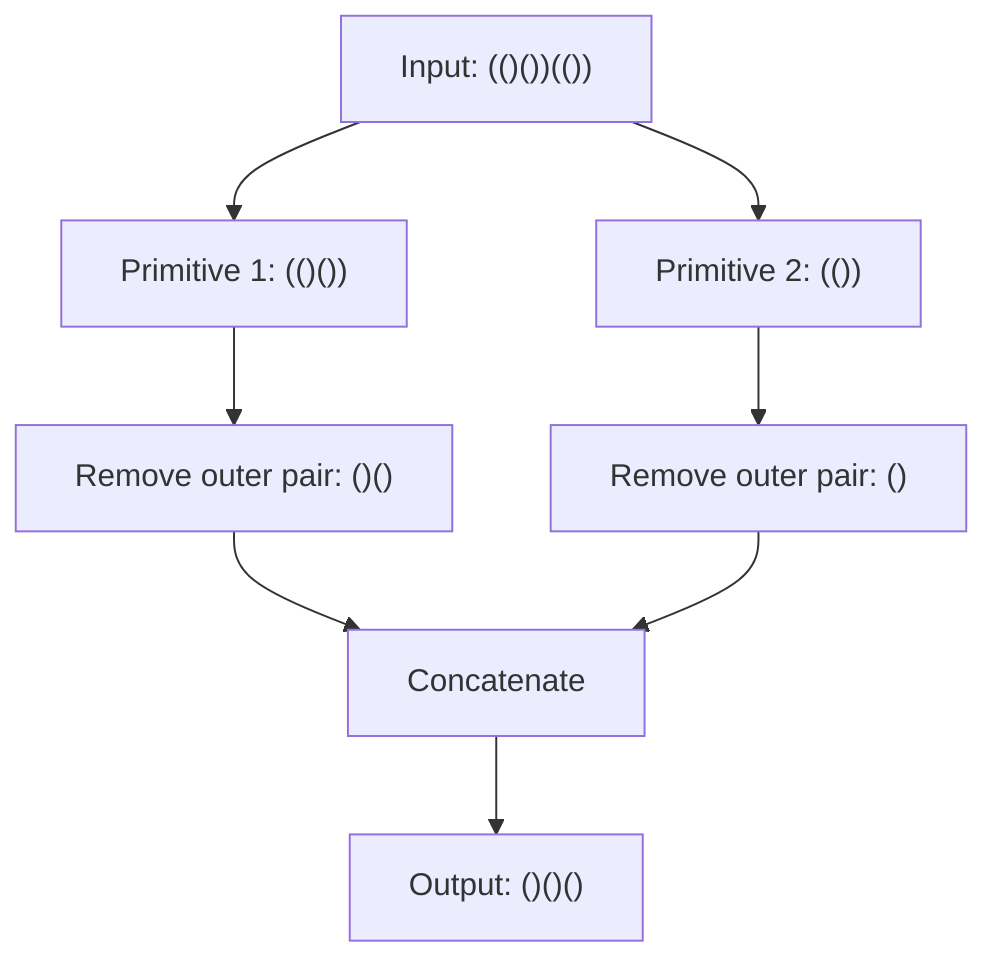

# 1021. Remove Outermost Parentheses

**LeetCode:** [1021. Remove Outermost Parentheses](https://leetcode.com/problems/remove-outermost-parentheses/)  
**Difficulty:** Easy · **Topics:** String, Stack

## Problem Statement
A valid parentheses string is empty, `"(" + A + ")"`, or `A + B`, where `A` and `B` are valid parentheses strings. A valid string is **primitive** if it is non-empty and cannot be split into two non-empty valid parentheses strings.

Given a valid parentheses string `s`, decompose it into primitive strings `s = P1 + P2 + ... + Pk`. Return the string after removing the outermost parentheses of every primitive part.

## Examples
1. **Input:** `s = "(()())(())"` → **Output:** `"()()()"`  
   `"(()())"` becomes `"()()"`, and `"(())"` becomes `"()"`.
2. **Input:** `s = "(()())(())(()(()))"` → **Output:** `"()()()()(())"`
3. **Input:** `s = "()()"` → **Output:** `""`

## Constraints
- `1 <= s.length <= 10^5`
- `s[i]` is `'('` or `')'`.
- `s` is a valid parentheses string.

## Visual Representation
```text
Input:       (()())(())
Primitive:   (()()) + (())
Remove:       ()()  +  ()
Output:      ()()()
```



## Function Signature
```cpp
string removeOuterParentheses(string s);
```

See `leetcode_1021_explanation.md` for both approaches and dry runs.
